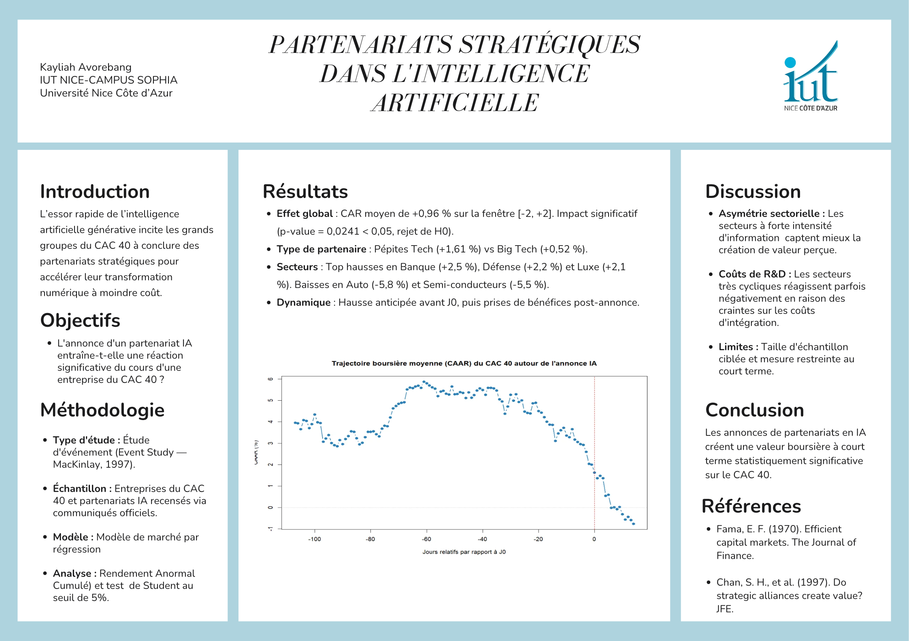
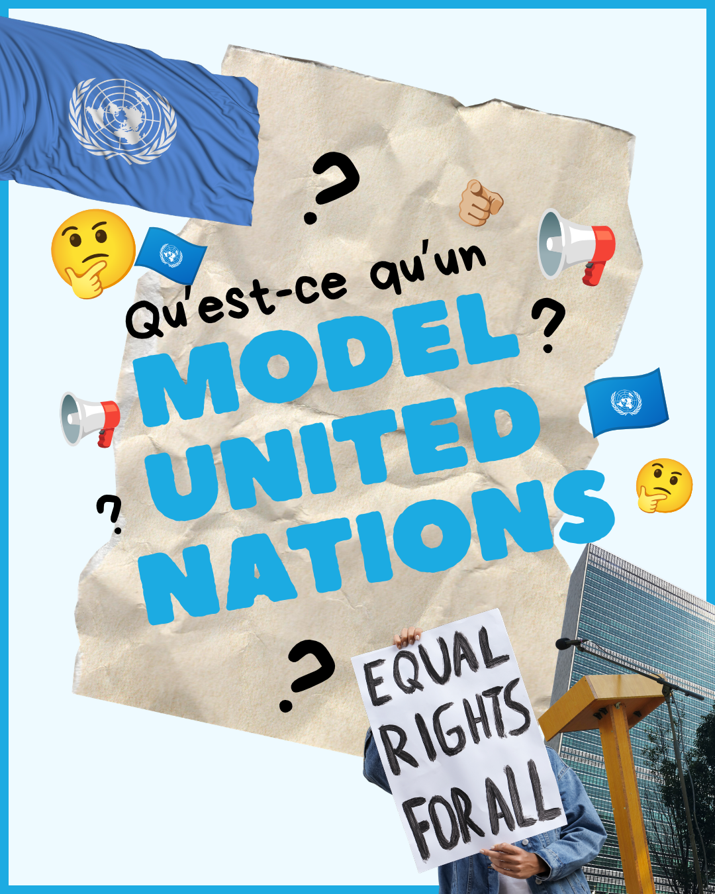
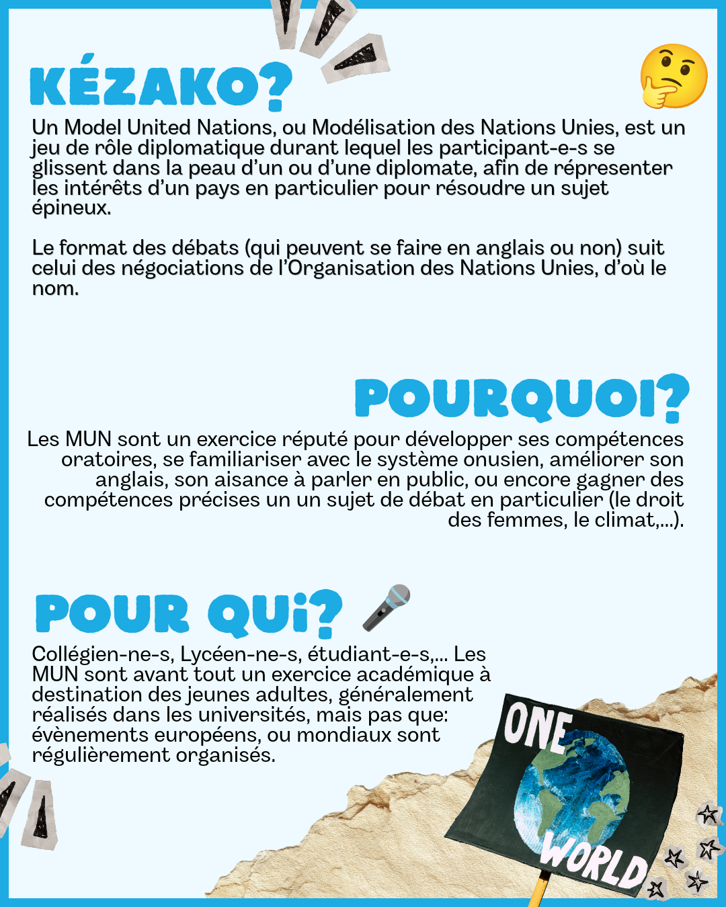

<h1 align="center">Bonjour, je suis Kayliah Avorebang 👋</h1>
<h3 align="center">Étudiante en Data à l'IUT Nice Côte d'Azur · Étudiante-entrepreneure · Jeune ambassadrice UNICEF</h3>

  

---

## 🙋‍♀️ À propos

Étudiante en data à l'IUT Nice Côte d'Azur (Campus Sophia Antipolis), je combine **analyse de données**, **entrepreneuriat** et **engagement associatif** : je transforme les données en décisions, et les idées en projets concrets.

- 🎯 Je recherche un **stage ou une alternance en data / BI**
- 🚀 Je développe **EventBridge**, une plateforme de mise en relation pour l'événementiel
- 🌍 Jeune ambassadrice **UNICEF**
- 🎨 J'aime rendre l'information lisible : dataviz, affiches, posters scientifiques

---

## 🚀 Entrepreneuriat

### EventBridge — *le lien entre vos idées et les bonnes personnes*
Plateforme qui met en relation les organisateurs d'événements (mariages, anniversaires, baby showers, événements professionnels) avec des prestataires : photographes, traiteurs, DJ, lieux de réception, fleuristes.
- **Prototype fonctionnel :** recherche de prestataires par ville et budget, demandes de devis, espace client avec suivi du budget et des tâches, espace prestataire avec vitrine, interface en 3 langues (FR · EN · IT)
- 🔗 [**Voir le prototype en ligne**](https://kayliahavorebang96-stack.github.io/kayliahavorebang96-stack/) · [code source](index.html)

---

## 📊 Projets Data

### Equitera — audit éthique du recrutement automatisé *(projet universitaire)*
> *« Un algorithme peut trier. Seul un humain peut décider. »*

Prototype d'outil RH qui contrôle un algorithme de tri de CV pour garantir que chaque refus automatique est validé par un humain, en conformité avec le **RGPD** et l'**AI Act** (qui classe le tri de CV comme système à haut risque).
- **Pilotage :** tableaux de bord interactifs (taux de refus par poste, carte des biais, score de conformité, évolution sur 3 mois glissants)
- **Contrôle humain :** audit des règles de tri (critères interdits, suspects ou légitimes), file de revue des refus, journal des décisions pour la traçabilité
- **Analyse d'équité femmes/hommes :** taux de sélection avec intervalles de confiance de Wilson, règle des quatre cinquièmes, test du khi-deux et test exact de Fisher, comparaison avant et après revue humaine
- **Conformité RGPD :** suivi de la durée de conservation des CV et purge des données expirées
- **Outils :** HTML, CSS, JavaScript, Google Sheets, Make (automatisation), 4 profils utilisateurs (admin, direction RH, responsable recrutement, recruteur)
- 🔗 [**Voir la démo**](https://kayliahavorebang96-stack.github.io/equitera/) · [code source](https://github.com/kayliahavorebang96-stack/equitera) — *données fictives*

### Partenariats stratégiques dans l'IA : quel impact boursier sur le CAC 40 ?
Étude d'événement (méthode de MacKinlay, 1997) mesurant la réaction du cours des entreprises du CAC 40 à l'annonce d'un partenariat en intelligence artificielle.
- **Méthode :** modèle de marché par régression, rendements anormaux cumulés (CAR/CAAR), test de Student au seuil de 5 %
- **Résultat clé :** rendement anormal moyen de **+0,96 %** sur la fenêtre [-2 ; +2], statistiquement significatif (p = 0,024)
- **Enseignement :** les partenariats avec des pépites tech (+1,61 %) sont mieux valorisés que ceux avec les Big Tech (+0,52 %)
- 🔗 [**Voir le poster**](poster-partenariats-ia.png)

### Analyse de l'activité d'un réseau ferroviaire — Power BI
Tableau de bord interactif de 7 pages pour piloter l'activité d'un réseau de trains : fréquentation, chiffre d'affaires, prix des billets, trajets et performance des trains.
- **Modèle de données :** schéma en étoile (voyageurs, trajets, trains, gares, villes, classes, satisfaction, calendrier)
- **Mesures DAX :** une table de mesures dédiée avec une vingtaine d'indicateurs (CA, prix moyen et maximum des billets, trajets annulés, répartition hommes/femmes, note de satisfaction moyenne…)
- **Analyses :** profil des voyageurs par âge, sexe et classe ; évolution du CA par mois et trimestre ; comparaison des villes et gares sur des cartes ; prix moyen par type de train
- **Ergonomie :** page d'accueil avec navigation par boutons, filtres par année et par ville
- 🔗 [**Télécharger le fichier Power BI (.pbix)**](powerbi-reseau-ferroviaire.pbix)

---

## 🎨 Communication & Design

  

<i>Poster scientifique — Partenariats stratégiques dans l'IA, IUT Nice Côte d'Azur</i>

  
  

<i>Campagne de sensibilisation — « Qu'est-ce qu'un Model United Nations ? »</i>

---

## 🌍 Engagement

**Jeune ambassadrice UNICEF**
- 🏛️ **Organisation d'un Model United Nations (MUN) :** participation à la réalisation d'une simulation des Nations Unies, où les participants jouent le rôle de diplomates pour débattre d'un enjeu international
- 🎨 **Communication :** création d'affiches et de visuels pour promouvoir les actions et les événements, dont le carrousel « Qu'est-ce qu'un Model United Nations ? »
- 📣 **Sensibilisation :** actions auprès des jeunes sur les droits de l'enfant et l'engagement citoyen

---

## 🛠️ Compétences

**Data & BI :** Power BI · DAX · Power Query · Excel · Google Sheets · statistiques (régression, tests d'hypothèse, analyse d'équité)
**Automatisation & conformité :** Make · RGPD · AI Act
**Communication & design :** Canva · création de supports visuels
**Entrepreneuriat :** conception produit · étude de marché · pitch

---

<i>« Des données aux décisions, des idées aux projets. »</i>

